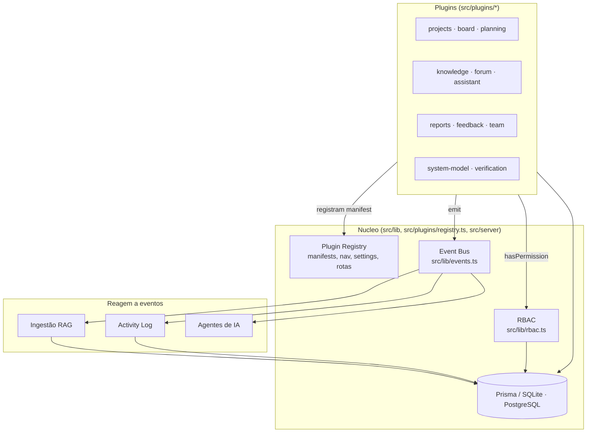
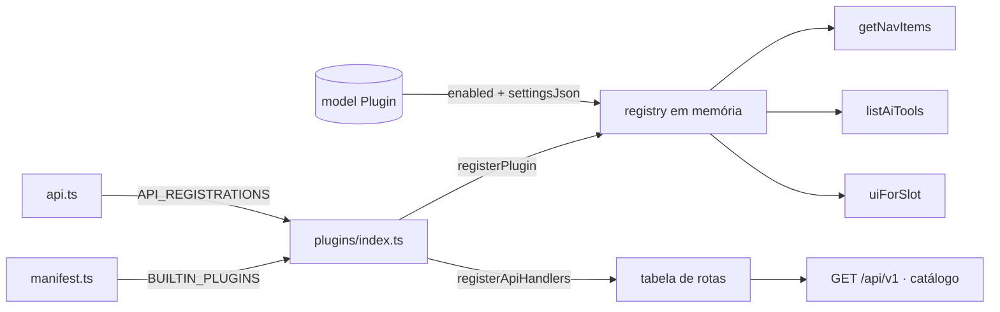
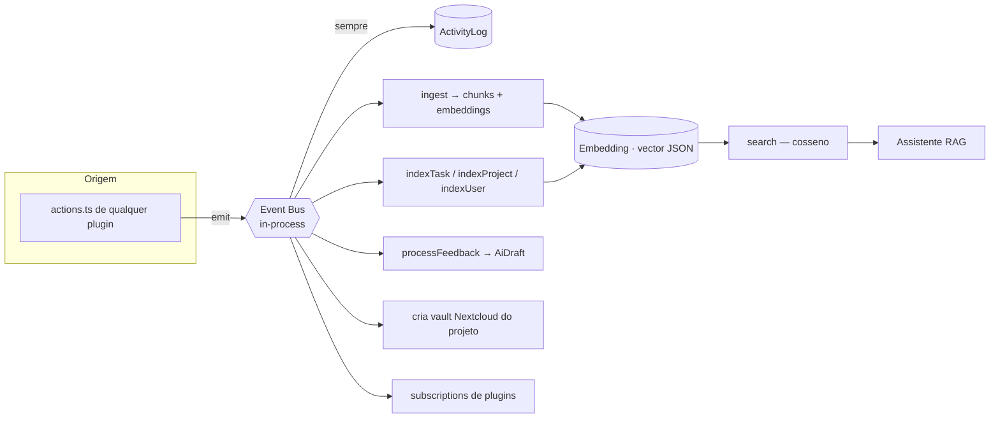
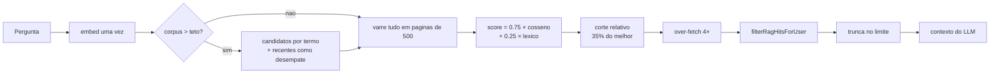
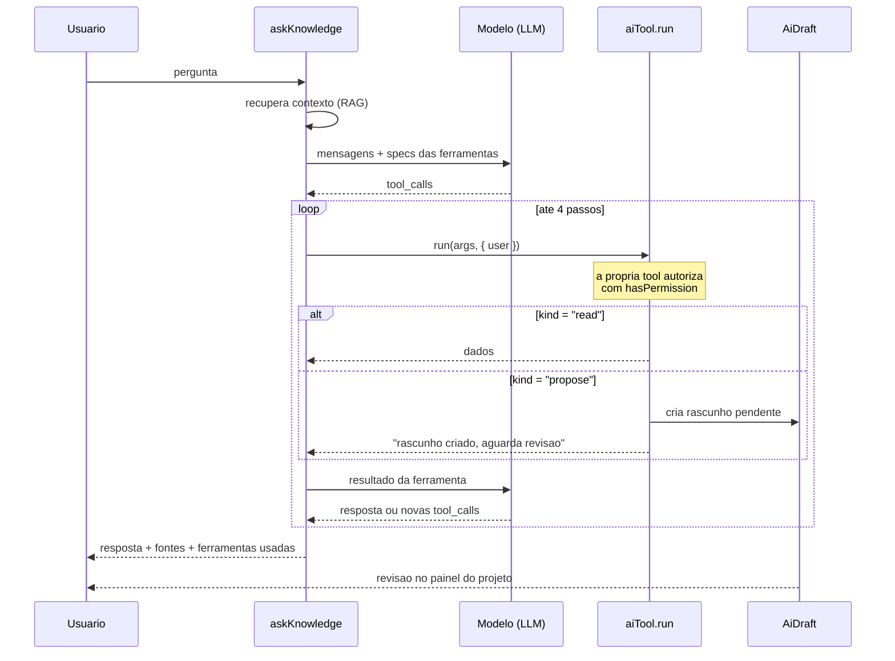
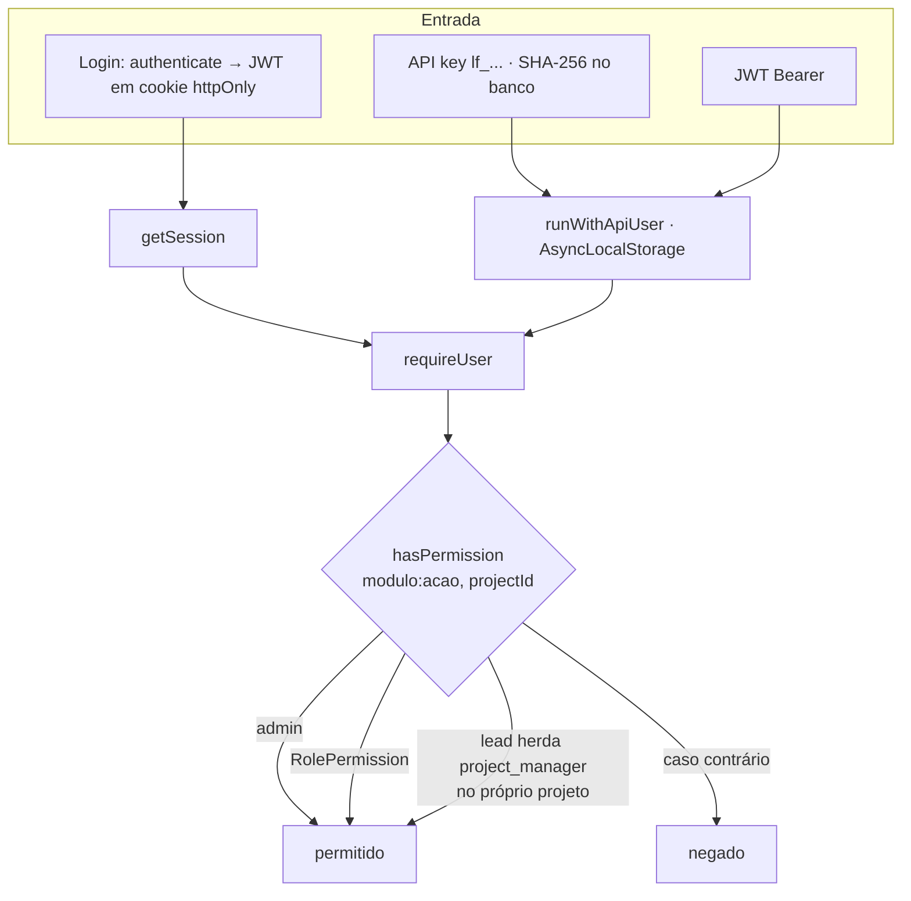
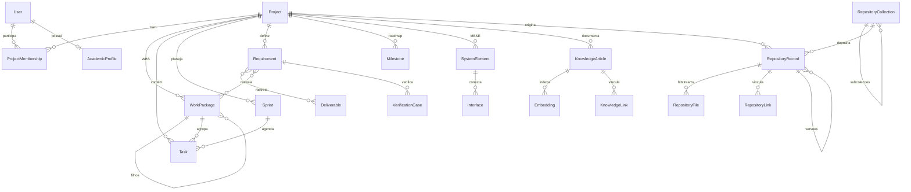

# LabFlow — Visão Geral da Arquitetura

Documento de referência para entender **como as peças se conectam** antes de mexer no código.
Para convenções e receitas por tarefa, veja [AGENTS.md](../AGENTS.md). Para instalar e rodar, veja [README.md](../README.md).

---

## 1. A ideia central

LabFlow é um **monólito Next.js com arquitetura de plugins**. Não existe um "core de funcionalidades" separado dos módulos: cada módulo do produto é um plugin, e o núcleo é apenas a infraestrutura que os carrega e os conecta.



O núcleo **não conhece** nenhum módulo pelo nome. A única lista acoplada é `src/plugins/index.ts`, que existe apenas porque os imports precisam ser estáticos.

---

## 2. Camadas

| Camada | Onde vive | Responsabilidade |
|--------|-----------|------------------|
| **Rotas** | `src/app/(app)/**`, `src/app/api/**` | Thin wrappers. Páginas reexportam o `page.tsx` do plugin; a API é um catch-all |
| **Módulos** | `src/plugins/<id>/` | Manifest, server actions, server page, handlers REST |
| **UI** | `src/components/<modulo>/`, `src/components/ui/` | Client components interativos e primitivas compartilhadas |
| **Domínio/infra** | `src/lib/**` | Auth, RBAC, eventos, IA/RAG, conhecimento, projetos, SE, notificações, backup |
| **Dados** | `prisma/schema.prisma` | 35 models |
| **Bootstrap** | `src/server/bootstrap.ts` | Liga eventos a subscribers, registra plugins, sobe schedulers |

Regra prática: **server components e actions ficam em `src/plugins/`; client components ficam em `src/components/`.** O `page.tsx` do plugin busca dados e passa props serializáveis para o client component correspondente.

---

## 2b. Escopo de workspace: o filtro que governa todos os números

Os toggles de contexto na topbar resolvem, a cada request, um conjunto de `projectIds`:

```
preferences.workspace (JSON em User.preferences)
        │
        ▼
resolveWorkspaceScope(user)   ── src/lib/workspace.ts
        │
        ├─ projectIds        projetos visíveis ∩ filtro
        ├─ visibleProjectIds tudo o que a pessoa vê, sem filtro
        ├─ focused           o filtro estreita o laboratório?
        └─ label             rótulo legível do contexto
        │
        ▼
páginas de plugin · dashboard · /reports · /gantt · activity log · e-mail semanal manual · API
```

Qualquer agregação por projeto passa por aqui. O contraexemplo que motivou centralizar isso:
o dashboard contava `prisma.task.count()` sem filtro, então desligar "acadêmicos" mudava
`/projects` e deixava o dashboard somando teses — os dois números discordavam na mesma tela.

`<WorkspaceScopeBar>` mostra "N de M projetos" e o rótulo do contexto, para que uma página
filtrada não pareça quebrada.

O agendador do relatório semanal não tem usuário e continua cobrindo o laboratório inteiro;
só a execução manual herda o escopo de quem clicou.

---

## 3. Ciclo de vida de um request

### 3.1 Página autenticada

```mermaid
sequenceDiagram
    participant B as Browser
    participant L as (app)/layout.tsx
    participant BS as bootstrapAsync()
    participant P as plugins/&lt;id&gt;/page.tsx
    participant DB as Prisma

    B->>L: GET /board
    L->>L: requireUser() — redirect /login se sem sessão
    L->>BS: bootstrapAsync() (idempotente)
    BS->>BS: registra plugins · seed permissões · migrações · schedulers
    L->>L: getNavItems() + 3 filtros de visibilidade
    L->>P: renderiza children
    P->>DB: consulta dados do módulo
    P-->>B: HTML + props para client components
```

**Não há middleware.** A autenticação de páginas mora em `requireUser()` dentro de `src/app/(app)/layout.tsx`. Toda rota criada fora de `(app)` nasce pública.

### 3.2 Mutação (server action)

```mermaid
sequenceDiagram
    participant C as Client component
    participant A as plugins/&lt;id&gt;/actions.ts
    participant DB as Prisma
    participant BUS as emit()
    participant S as Subscribers (bootstrap.ts)

    C->>A: server action
    A->>A: requirePermission("modulo:acao", projectId)
    A->>DB: create / update / delete
    A->>BUS: emit({ type, actorId, projectId, targetId, payload })
    BUS->>DB: grava ActivityLog (best-effort)
    BUS->>S: notifica subscribers
    S->>S: ingest RAG · index · feedback agent
    A->>A: revalidatePath(...)
    A-->>C: { ok } ou { error: "mensagem" }
```

### 3.3 API REST

```mermaid
sequenceDiagram
    participant X as Cliente externo
    participant R as api/v1/[...path]/route.ts
    participant AU as api-auth.ts
    participant RG as registry (matchApiHandler)
    participant H as plugins/&lt;id&gt;/api.ts

    X->>R: GET /api/v1/board/tasks
    R->>R: bootstrapAsync()
    R->>AU: Bearer lf_... → Bearer JWT → cookie de sessão
    AU-->>R: SessionUser ou 401
    R->>RG: plugin habilitado? handler existe?
    RG-->>R: handler + params (404 se não)
    R->>H: runWithApiUser(user, handler)
    Note over H: AsyncLocalStorage faz getSession()/requireUser()<br/>enxergarem o usuário da chave
    H-->>X: { ok: true, data } ou { ok: false, error }
```

O `runWithApiUser` é o truque que permite **reaproveitar as mesmas server actions da UI na API**, com o mesmo RBAC — normalmente via `runApiAction(() => minhaAction(...))`.

---

## 4. Sistema de plugins

### Contrato

Tudo passa por `PluginManifest` ([`src/plugins/types.ts`](../src/plugins/types.ts)):

```typescript
export const meuManifest: PluginManifest = {
  id: "meu-modulo",              // vira /api/v1/meu-modulo
  name: "Meu Módulo",
  version: "1.0.0",
  requires: ["projects"],        // dependências entre plugins
  nav: { label, href, icon, order, group },
  settingsSchema: [...],         // formulário em Configurações
  apiPrefix: "/api/v1/meu-modulo",
  subscriptions: [...],          // reage a eventos
  aiTools: [...],                // funções que o agente pode chamar
  ui: [...],                     // componentes em slots nomeados
  lifecycle: { onBoot, onEnable, onDisable, onSettingsChange },
};
```

### Registro e estado



O **manifest é código** (declaração estática) e o **estado é banco** (`model Plugin`: `enabled`, `settingsJson`; `model PluginProjectSettings` para overrides por projeto). `initPluginRegistry()` funde os dois no boot.

### Slots de UI

`dashboard.widgets` · `sidebar.nav` · `project.tabs` · `task.panel`.
Hoje só `dashboard.widgets` tem consumidor real, no plugin de exemplo.

### Plugin de referência

[`src/plugins/example/index.ts`](../src/plugins/example/index.ts) exercita **todos** os pontos de extensão em ~60 linhas: `aiTools` com RBAC, widget de dashboard e subscriber de evento. É o melhor lugar para começar.

---

## 5. Event bus e o pipeline de conhecimento



Pontos que importam:

- `emit()` **sempre** grava em `ActivityLog` antes de notificar — é isso que alimenta a timeline e o BI de relatórios.
- Subscribers são registrados uma única vez em `bootstrap()`, protegido por `globalThis.__labflowBootstrapped`.
- O bus é in-process por design. O comentário em `events.ts` prevê a troca por BullMQ/Redis mantendo os mesmos contratos de evento.
- **Se conteúdo novo não aparece no assistente**, o problema quase sempre é um `emit()` faltando na action — não o RAG.

---

## 6. Camada de IA

```mermaid
graph TB
    CFG[".env AI_* + settings do plugin assistant"] --> PROV[provider.ts<br/>chat · embed · aiEnabled]
    PROV -->|openai| OAI[OpenAI API]
    PROV -->|ollama| OLL[Ollama local]
    PROV -->|none| LOC[embeddings.ts<br/>vetor local hashed]

    PROV --> RAGX[rag.ts<br/>ingest · search · purge]
    RAGX --> EMB[(Embedding)]
    RAGX --> AG[agent.ts<br/>assistente]
    TOOLS[aiTools dos plugins] --> AG
    AG --> UI[/assistant]

    PROV --> FB[feedback-agent.ts]
    PROV --> ART[artifacts/*<br/>ConOps, drafts, import/export]
    FB --> DR[(AiDraft)]
```

- Settings do plugin `assistant` **sobrescrevem** o `.env` em runtime (Configurações → IA).
- `AI_PROVIDER=none` degrada com elegância: busca híbrida local + resposta extrativa dos chunks.
- Vetores em JSON (`Embedding.vector`) — portável entre SQLite e PostgreSQL. Para escala, migre a coluna para `pgvector` e ajuste `rag.ts`.

### Recuperação: como um trecho vira contexto



Três invariantes sustentam isso:

1. **Compatibilidade de modelo.** Cada vetor guarda o `modelName` que o gerou e a busca filtra por
   ele. Cossenos entre modelos diferentes não significam nada, e comparar dimensões diferentes
   dava zero em silêncio. Trocar de modelo exige `reindexAll()` — exposto em Configurações → IA.
2. **Truncar por relevância, nunca por recência.** O teto (`ragScanLimit`, `0` = sem limite) escolhe
   candidatos por correspondência de termos. Ordenar por data e cortar fazia a base esquecer
   permanentemente tudo além do teto.
3. **Permissão antes do corte.** Buscar 4× o limite, filtrar acesso, depois truncar. Filtrar depois
   deixava sem contexto quem não tinha acesso aos melhores resultados.

### Ferramentas: o assistente propõe, a pessoa decide



Regra da plataforma: **nenhuma ferramenta muta dados de domínio**. Uma tool `propose` cria um
`AiDraft`, que reaparece no painel de rascunhos do projeto para alguém aceitar — o mesmo caminho
que o `feedback-agent` já usava. Isso mantém uma pessoa no circuito sem transformar o assistente
em algo puramente consultivo.

Cada tool autoriza a si mesma com `ctx.user`; o loop nem oferece ferramentas quando não há
usuário autenticado. Modelos locais sem suporte a function calling são detectados e a resposta
sai só com o contexto do RAG.

### Quando o provedor falha

Não existe degradação silenciosa. Com provedor configurado:

| Falha | Comportamento |
|-------|---------------|
| Chat com erro/timeout | `AiProviderError` com status e mensagem; `askKnowledge` devolve `degraded: true` e a UI mostra o motivo com botão de repetir |
| 429 / 5xx / rede | 3 tentativas com backoff exponencial antes de desistir |
| Modelo de embedding ausente | Cai para vetores locais, registra o motivo, e o painel de índice exibe o aviso |
| Sem provedor (`none`) | Modo offline explícito, com badge na UI |
| Modelo sem suporte a tools | Repete a chamada sem ferramentas e avisa no log |
| Tool lança exceção | O erro vira resultado da ferramenta para o modelo, não um crash |

Toda execução vai para `AgentRun` com latência, tokens, ferramentas e erro — visível em
*Configurações → IA*.

---

## 7. Autenticação e autorização



**Três níveis de papel, frequentemente confundidos:**

| Nível | Onde | Valores |
|-------|------|---------|
| Global | `User.role` / `UserProfile` | `admin`, `researcher`, `project_manager`, `contributor`, `viewer` |
| Por projeto | `ProjectMembership.role` | `lead`, `contributor`, `viewer`, `advisor`, `coauthor` |
| Acadêmico | `AcademicProfile.program` | `msc`, `phd`, … — **não é papel de acesso** |

As chaves de permissão (`modulo:acao`) e o mapa papel → permissões vivem em [`src/lib/permissions-seed.ts`](../src/lib/permissions-seed.ts), re-semeados a cada boot. Admins podem reconfigurar o mapa pela UI (`model RolePermission`).

Conhecimento tem uma camada extra em [`src/lib/knowledge-access.ts`](../src/lib/knowledge-access.ts): visibilidade por projeto e artigos vindos do Nextcloud marcados como somente-leitura.

---

## 8. Modelo de dados

40 models em [`prisma/schema.prisma`](../prisma/schema.prisma), agrupados por domínio:



| Grupo | Models |
|-------|--------|
| Pessoas e acesso | `User`, `UserProfile`, `ProjectMembership`, `AcademicProfile`, `ApiKey`, `Permission`, `RolePermission` |
| Trabalho | `Project`, `WorkPackage`, `Task`, `Label`, `Sprint`, `Deliverable`, `Milestone`, `Comment` |
| Engenharia de sistemas | `Requirement`, `SystemElement`, `Interface`, `VerificationCase` |
| Conhecimento | `KnowledgeArticle`, `Embedding`, `KnowledgeLink` |
| Repositório institucional | `RepositoryCollection`, `RepositoryRecord`, `RepositoryFile`, `RepositoryLink`, `RepositorySubject` |
| Colaboração | `Channel`, `Thread`, `Post`, `Notification`, `Feedback`, `FeedbackComment` |
| Plataforma | `Plugin`, `PluginProjectSettings`, `SystemSetting`, `ActivityLog`, `AgentConfig`, `AgentRun`, `AiDraft` |

**Duas convenções que causam bugs se ignoradas:**

1. **Enums são `String`.** Não há tipo enum no schema — a validação é responsabilidade da action.
2. **JSON é `String`.** Campos como `Project.featuresJson`, `Project.conops`, `Task.checklistJson`, `User.preferences`, `AcademicProfile.coursesJson`, `RepositoryRecord.authorsJson` e `RepositoryRecord.subjectsJson` guardam JSON serializado. Sempre use os helpers de parse (`parseProjectFeatures`, `parsePreferences`, `parseChecklist`, `parseAuthors`, `parseSubjects`) em vez de `JSON.parse` cru.

**Biblioteca e repositório não são a mesma coisa.** `KnowledgeArticle` é wiki espelhado do vault
Nextcloud — editar no LabFlow um artigo sincronizado é perder a edição no próximo sync.
`RepositoryRecord` é depósito citável: handle estável, metadados bibliográficos, versões e bytes
em **disco local** (`REPOSITORY_STORAGE_DIR`), sem dependência externa. Os dois alimentam o mesmo
índice de embeddings, com `sourceType` diferente (`article` e `repository_record`), e o assistente
busca nos dois como um corpus só.

---

## 9. Bootstrap: o que roda no boot

`bootstrapAsync()` é chamado pelo layout autenticado e pelas rotas de API. É idempotente, mas roda em todo request — mantenha barato o que for adicionado.

| Fase | Ação |
|------|------|
| Síncrona (uma vez) | Registra subscribers de evento; `registerBuiltinPlugins()` |
| Registry | `initPluginRegistry()` — funde manifests com o estado em banco |
| Schedulers | Auto-sync Nextcloud, notificador de prazos, agendador de backup |
| Migrações de dados | `seedPermissions`, `migrateUserProfiles`, `migrateRoles`, migração acadêmico → projetos |
| Seeds de conteúdo | Artigos de formato (artefatos, bundles), metodologia acadêmica, `docs-seed` |
| RAG | `ensureKnowledgeIndexed()` (assíncrono, best-effort) |

---

## 10. Superfícies externas

| Superfície | Arquivo | Observação |
|------------|---------|------------|
| API REST de plugins | `src/app/api/v1/[...path]/route.ts` | Catch-all; catálogo em `GET /api/v1`; responde `OPTIONS` |
| Login por token | `src/app/api/v1/auth/token/route.ts` | Troca e-mail/senha por JWT — para UI fora do Next |
| Identidade e permissões | `src/app/api/v1/me/route.ts` | Permissões efetivas + nav filtrado + escopo ativo |
| Especificação OpenAPI | `src/app/api/v1/openapi.json/route.ts` | OpenAPI 3.1 gerado do registry em runtime |
| CORS | `src/plugins/api-cors.ts` | Allowlist em `API_CORS_ORIGINS`; nada liberado por padrão |
| Arquivos do repositório | `src/lib/repository/storage.ts` | Disco local; download via `GET /api/v1/repository/files/:id/download` |
| Backup | `src/app/api/admin/backup/route.ts` | Agendado por `src/lib/backup-scheduler.ts` |
| Download de arquivo do vault | `src/app/api/knowledge/file/[id]/route.ts` | Serve anexos da biblioteca |
| Nextcloud (saída) | `src/plugins/knowledge/nextcloud-client.ts` | WebDAV; artigos sincronizados são read-only |
| SMTP (saída) | `src/lib/mail.ts` | Notificações e relatórios semanais |
| Import/export | `src/lib/data-transfer/*`, `src/lib/artifacts/*` | Bundles de projeto/usuário, artefatos de IA |

---

## 11. Onde a documentação vive

| Destino | Arquivo | Público |
|---------|---------|---------|
| Repositório | `AGENTS.md` | Agentes de IA — convenções e receitas |
| Repositório | `docs/ARCHITECTURE.md` | Este arquivo — visão geral |
| Repositório | `README.md` | Humanos — instalação e uso |
| Repositório | `docs/CURSOR.md` | Workflow com agentes |
| Repositório | `.cursor/rules/*.mdc`, `.cursor/skills/*/` | Cursor |
| **Produto** | `src/lib/docs-seed.ts` | Artigos semeados na base de conhecimento, consultáveis pelo assistente |

⚠️ Mudança relevante de arquitetura precisa ser refletida em **`AGENTS.md`, aqui e em `docs-seed.ts`**. O último é o que o assistente in-app lê — se ficar desatualizado, a plataforma passa a responder errado sobre si mesma.
